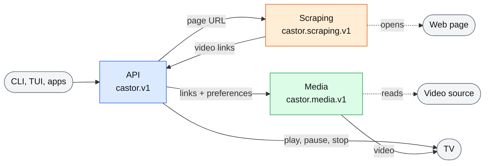
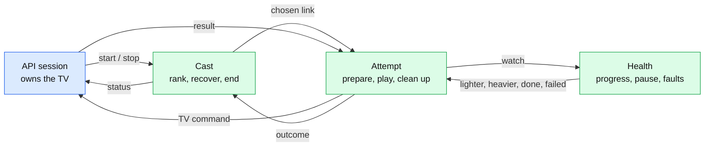
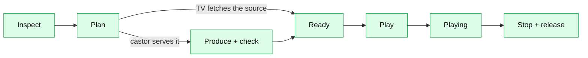
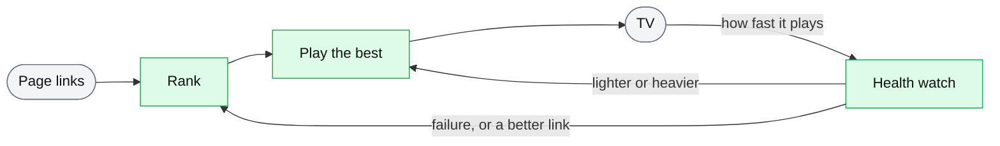

# Architecture

Castor is three services in one binary. `castor cast` runs all three in its own process, and each can also run on a machine of its own. Either way they talk through the same Connect/protobuf contracts in [`proto/`](proto/).

## The three services



| Service | What it does | Runs where |
| --- | --- | --- |
| API | Finds and controls TVs, runs each cast, reports its status | It can reach the TVs |
| Scraping | Opens pages in Chrome and finds their video links | Chrome is installed |
| Media | Picks the best link, transcodes, adds subtitles, serves the TV, recovers from failures | The TVs can reach it |

- Clients own the catalog and the interface; the API is the only service they talk to.
- A direct video URL skips scraping.
- When the TV can play the source as it is, it fetches it directly. Otherwise media serves it.
- Only media needs cgo, for Whisper. How the code is split is in [CONTRIBUTING.md](CONTRIBUTING.md#held-in-review).

## How a cast runs

1. The API gives the cast an ID, which follows it through every service and log line.
2. It connects the TV, asks scraping for the page's links, and hands them to media.
3. Media ranks the links and plays the best one. Each try at a link is an attempt.
4. While the TV plays, a health watch follows its progress and asks for a lighter or heavier stream.
5. When an attempt fails, media cleans it up completely before trying a cheaper fix or the next link.

Media makes the decisions; the API carries them out on the TV, over the `Drive` and `Answer` streams. A cast keeps running if the client disconnects, and each service finishes its own work when it shuts down.



Each box is a typed state machine: it moves through named states and refuses an event its current state does not take.

An attempt always runs the same chain. Play is only asked for once the output is ready, and any failure goes straight to cleanup:



## Choosing and adapting what plays

| Decision | Made by | When |
| --- | --- | --- |
| Which link to play | Ranking | Before the cast, and on recovery |
| How much the TV's link can take | Health watch | While the TV plays |
| How to change the stream without the TV noticing | Delivery | When the health watch asks |



### Ranking

Pages often offer several links, some of them decoys. Castor probes each one:

- **Dropped:** a browser-internal handle, a link the server refuses, a link with no moving picture.
- **Last resort:** a link it could not measure, one shorter than a feature, a bare MP4 header.
- **Admitted:** everything else, sorted by: measured first, within the height cap, in the audio language you asked for, offers several qualities, picture height, then bitrate.

Language beats picture: a worse picture in your language wins over a better one in another. From a playlist with several qualities, castor reads the best one the height cap and bitrate ceiling allow, or else the lightest.

### Following the TV's speed

- Castor reads the source once into a buffer on disk. Encoders run about 10 seconds ahead of the TV, so a change reaches it within seconds.
- Every 5 seconds it asks the TV where it is, and measures how fast it played over the last 30 seconds. A TV that reports no position is judged by how many bytes it takes.
- **Too slow** (under 0.9× real time): the stream drops to 0.75 of what the TV took, never under 1 Mbit/s. A TV that keeps up is never lightened.
- **Room to spare** (0.97× or better for 3 minutes): castor tries a heavier stream, then every 90 seconds once one holds. If the TV falls behind, it goes back at once and leaves that rate alone for 10, then 20, then 40 minutes.
- A paused TV can stop reading for as long as it likes; only the health watch decides a TV is gone.
- Nothing carries over between casts: each starts at your `max_bitrate`, which covers picture and sound together.

### Seeking on a DLNA TV

A DLNA TV can seek when castor serves it a single MPEG-TS stream, from a source with a known duration and no generated captions. Castor then reads the source again from the new position, at the same quality and rate, and serves it on the same URL.

### Changing the stream mid-play

- A change is a cut at a keyframe: the running encoder stops and a new one starts there, so the TV sees one continuous stream.
- If the source has a quality that fits the new rate, castor switches to it. That needs a keyframe both qualities share within 20 ms and the same codecs; otherwise castor encodes the current quality lighter.
- Sound already sent is not sent again.
- Only MPEG-TS streams can be cut this way.

### Recovering, and climbing back

- **A link fails:** castor tries the cheapest fix first (a slower read, another decoder, serving instead of a direct fetch) and the next link last, resuming where the viewer was.
- **It fell to a worse link:** after 10 minutes of good playback it retries the best one. If that fails, it goes back down and waits 20, then 40 minutes.

### Limits

- A cut can drop up to about 150 ms of sound.
- Switching quality resizes the picture; it is only tested on the end-to-end test receiver.
- Only the video rate changes during a cast; audio codec and container are fixed at the start.
- A source with a single quality can only be made lighter by encoding.
- The disk buffer grows with the video, so the temporary directory needs that much free space.
- A bigger buffer does not make the TV's link faster; it only smooths short dips.

## Media contracts

Media keeps apart what a source claims, what castor measured, and what the output must keep:

| Evidence | Meaning |
| --- | --- |
| `Declaration` | What a manifest says about its codecs and qualities. It never proves a probe succeeded or that a track is absent. |
| `Observation` | What a probe measured, tied to the exact URLs, headers and tracks it read. If those change, it is measured again. |
| `TrackRequirements` | The tracks the output must keep. |

- HLS and DASH details stay in their source adapters; the rest of media works on normalized programs.
- Every track is explicitly copied, encoded or left out. A stream castor cannot identify still counts as present and cannot silently disappear.
- Ready means either the TV may fetch the source directly, or castor has a checked output to serve. Failures after that still reach the attempt and its recovery.

## Deployment and trust

API runs where it can reach the TVs, scraping where Chrome is installed, and media where the TVs can fetch from it. CLI commands start whichever services are not configured; each standalone command starts only its own:

| Command | Default port | Runs where |
| --- | --- | --- |
| `castor media-server` | 8410 | The TVs can fetch its media URLs |
| `castor scraping-server` | 8412 | Chrome is installed |
| `castor api-server` | 8411 | It can discover and control the TVs |

- A standalone API server needs `servers.media.url` and its token. It reaches scraping at `servers.scraping.url`, or `http://localhost:8412` when unset.
- Clients set `servers.api.url` and `servers.api.token`.
- Standalone servers listen on all interfaces, so use HTTPS outside a trusted network.

The API lists devices and starts, stops and watches casts through [Connect contracts](proto/castor/v1), for example:

```sh
curl -X POST http://localhost:8411/castor.v1.DeviceService/ListDevices \
  -H "Authorization: Bearer $TOKEN" \
  -H 'Content-Type: application/json' -d '{}'
```

The [Compose stack](docker-compose.yml) runs all three with host networking ([how to start it](README.md#the-whole-stack)). A media container on a bridged network needs `-p 8410:8410` and a TV-reachable `servers.media.advertise`. Image tags are `latest` (stable), `canary` (preview) or a pinned `vX.Y.Z`.

Each service has its own bearer token. Health checks and the TV-facing `/media` routes are open; published streams use random paths. Replay headers reach media but never appear in public cast listings. See [SECURITY.md](SECURITY.md).
