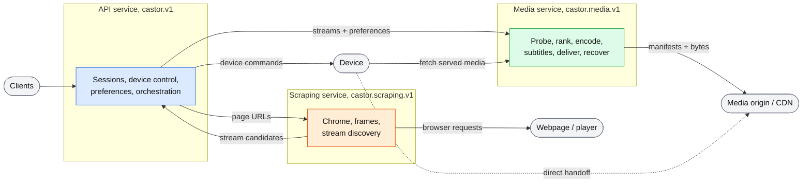
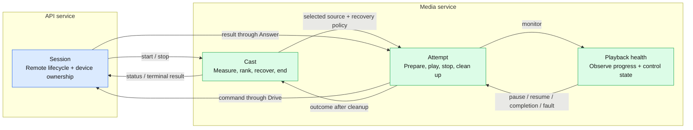
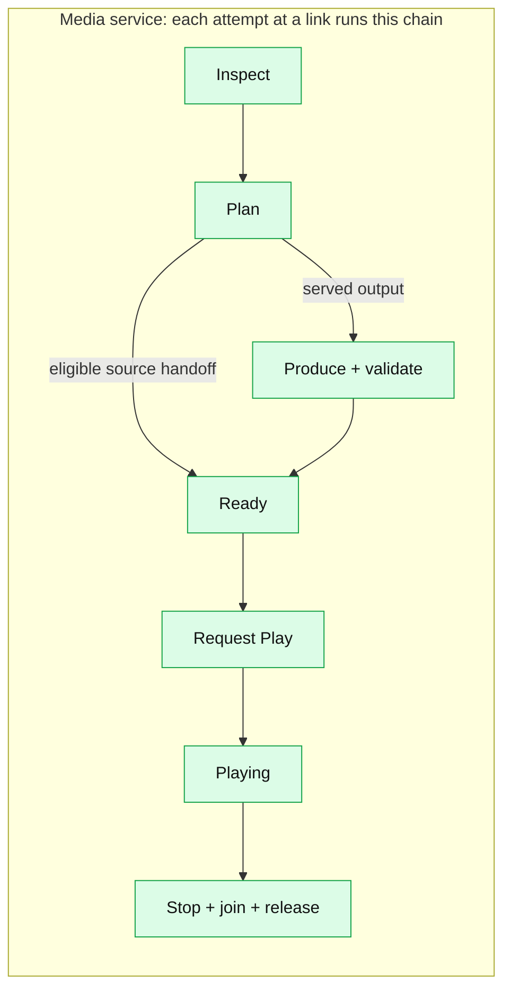
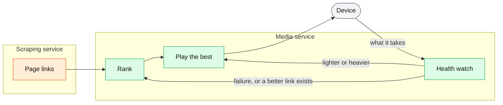

# Architecture

Castor ships three independent services in one binary. They can run embedded or remotely through the same Connect/protobuf contracts.

## Services and ownership



| Owner | Responsibility | Contract |
| --- | --- | --- |
| Clients | Catalog, source selection, UI | `castor.v1` |
| API | Device discovery/control, preferences, orchestration, public status | `castor.v1` |
| Scraping | Chrome, frames, stream discovery and replay headers | `castor.scraping.v1` |
| Media | Source selection, probing, ranking, encoding, subtitles, delivery and recovery | `castor.media.v1` |

Scraping discovers stream URLs from webpages. Media receives those URLs and fetches their manifests and bytes. Direct streams bypass scraping; candidate lists are ranked and retained for recovery. One candidate can contain multiple HLS/DASH renditions.

Services share generated contracts from [`proto/`](proto/), validated at RPC boundaries. Consumers define narrow ports; service entry points wire adapters, and binary main composes services. Domain implementations stay within each service's `internal` packages. Shared plumbing owns configuration, authentication and telemetry. Only media requires cgo for Whisper.

## Cooperating state machines

API creates a cast ID, connects the device, resolves pages and starts media. It opens `Watch` for status and `Drive` for device commands; command results return through `Answer`. Media makes playback decisions while API executes device operations on the device's network. The same cast ID follows RPCs and logs.



Each machine owns its transitions over typed states and events: one shared machine type runs them, traces each state visited, and refuses an event its state does not take. The cast runs attempts sequentially: recovery can revise delivery or choose another candidate only after the previous attempt has finished cleanup. Health observes and proposes actions; the attempt applies them and reports command outcomes. Health judges what the read makes and what the device takes. A device whose link cannot carry the cast is neither held nor sent elsewhere: the delivery changes how it is made while the device plays it, cutting from one encoder to the next, or to a lighter rung of the source, at a keyframe so the device sees one stream, and goes heavier again once the link has room. Candidates are ranked by language first, then picture, then bitrate, and a cast that fell to a lower ranked link goes back to a better one once it has played well. See the next section for how.

Within an attempt, operations return typed inputs for the next stage:



Only a certified ready presentation can request Play. Cancellation or failure from any active stage enters cleanup. The attempt joins preparation, producers and active delivery requests before releasing storage. API joins its Watch and Drive workers before releasing the device. A cast belongs to API independently of UI connections; each service drains its own work on shutdown.

## How a cast picks and changes what it plays

Three decisions, each owned by one part, none knowing the others' rules:

| Decision | Owner | When |
| --- | --- | --- |
| Which link to cast | Ranking | Before the cast, and again on recovery |
| Which rate the device can take | Health watch | While the device plays |
| How to change the stream without the device noticing | Delivery chain | When the watch asks |



### Ranking

A page can offer many links, some of them decoys. Each is probed, then dropped, kept as a last resort, or admitted:

- **Dropped:** a browser-internal handle, a link the origin refuses, a link with no moving picture.
- **Last resort:** a link that could not be measured, one shorter than a feature, a bare MP4 header.

Admitted links are ordered by the first difference in this list: measured before last resort, under the height cap, **sound language asked for (earlier languages win)**, carries a ladder of renditions, picture height, bitrate. Language comes before any quality: a worse picture in the right language beats a better one in another.

A link that is a master playlist lists several renditions. The one read is the best the height cap and the rate ceiling allow, else the lightest.

### Following the device's rate

The source is read once into a buffer on disk. Encoders read that buffer and feed the device, running only about 10 seconds ahead of it, so a change reaches the device within seconds.

The health watch judges the link by how fast the device plays. Every family reports the device's own position (DLNA from its transport, a Chromecast from its media status, a Roku from its media player); it is asked every 5 seconds, and its pace is the media it played per second of wall clock over the last 30 seconds. The pace is measured from when the device's position first moves, after it is asked to play, released from a pause, or seeks, since the seconds a device takes to start say nothing of its link; a change of rate starts every measure over. A device that cannot say, such as a renderer that answers no position, is judged by the bytes it takes per second against what the cast weighs.

- **Too slow:** a device playing under 0.9 of real time is asked to weigh 0.75 of what it took, never under 1 Mbit/s. A device playing in real time is never lightened, however little it reads: a device that plays what it takes keeps a thin buffer and reads exactly the cast's rate.
- **Room to spare:** after 3 minutes at a pace of 0.97 or more, a heavier rate is tried (90 seconds once one has held). If the device falls short of it, the old rate is given back at once and that rate is left alone for 10 minutes, then 20, then 40.

A device its viewer pauses stops reading for as long as it likes: the stream has no write deadline, and DLNA renderers are told they may stall the connection rather than drop it, so only the health watch decides a quiet device is gone.

Nothing is kept between casts: each starts at the operator's `max_bitrate` and finds the link while it plays. The ceiling bounds the picture and the sound together: a sound whose weight is unknown, or too heavy for its share, is encoded lighter.

### Seeking

A DLNA device fetches the stream from a position with `TimeSeekRange.dlna.org`, which castor announces (`DLNA.ORG_OP=10`) only for an MPEG-TS stream it serves from one read of a source with a declared duration and no generated captions. Castor then reads the source again from that position, in the rung and at the rate the cast stands at, cuts the encoders over to the new read, and serves the stream made from there on the same URL. The health watch starts its measures over from where the new stream begins, and a recovery resumes from where the device says it is.

### Changing the stream

A change is a cut: the running encoder stops at a keyframe and a new one starts there, so the device sees one continuous stream.

1. If the source has a rung that fits the new rate, it is read from a little before the cut. Otherwise the same rung is encoded lighter.
2. The cut is a keyframe the running encoder has not reached yet, far enough ahead for the new one to warm up. If the encoder gets there first, the cut is retried further on.
3. For a rung change the cut must be a keyframe both rungs have, at the same time within 20 ms. If none is found, or the rung carries other codecs or sound, the cast is made lighter on the rung it already reads.
4. Sound frames the old stream already gave are dropped from the new one, so nothing is heard twice.

Only deliveries served as one growing stream with in-band decoder configuration (MPEG-TS) can be cut this way. How a container is scanned for keyframes is a pluggable framing.

### Falling down and climbing back

- **A link fails:** recovery tries the cheapest fix first (slower read, different decode, serve instead of hand off) and the next ranked link last. A restart resumes from where the viewer got to.
- **A better link exists:** a cast that fell to a lower ranked link retries the best one after 10 minutes of good playback, with a short gap. If it fails, the cast goes back down and waits twice as long (20, then 40 minutes). If none can be read, it plays on.

### Limits

- A cut can lose up to about 150 ms of sound.
- A rung change resizes the picture; only tested on the e2e receiver, not on every device.
- Only the video rate changes across a cut. Audio codec and container are fixed at the start.
- A source with a single rendition is only made lighter by encoding.
- The disk buffer grows with the film; it needs that much free space in the temporary directory.
- A bigger buffer in castor does not raise what the device's link carries; it only smooths short dips.

## Media contracts

The engine separates what a source declares, what was observed, and what output must preserve:

| Evidence | Meaning |
| --- | --- |
| `Declaration` | A manifest's codec and rendition envelope; cannot establish successful probing or track absence. |
| `Observation` | Probe facts bound to the inspected URLs, formats, headers, representations, selected tracks and clock. Changed bindings invalidate reuse. |
| `TrackRequirements` | Tracks the output must retain, derived from mandatory selections and positive source evidence. |

- **Source adapters own format details.** HLS/DASH adapters resolve manifests, select resources and decode their envelopes. A shared relay handles bounded reads, caching and timeline publication. Core orchestration works with normalized programs and capabilities.
- **Planning uses measured media.** Ranking summaries remain separate from bound observations. Republishing under a local URL requires inspecting that reading; output validation retains the original program's track requirements.
- **Track choices are explicit.** Every track is copied, encoded or omitted. An unfinished plan cannot build an FFmpeg command. Stream presence is separate from codec parameters: an unidentified stream is present and cannot silently disappear.
- **Readiness follows the delivery path.** Direct handoff requires source/receiver eligibility. Served output requires an available, validated artifact. Output adapters own packaging and publication; capability checks govern compatibility. Live-source evidence describes observed media and cannot guarantee future segments.
- **Failures remain observable.** Readiness does not end monitoring: reader, producer and playback failures feed the attempt outcome and cast recovery.

## Deployment and trust

API runs where it can reach devices; scraping runs with Chrome; media runs where devices can fetch its published URLs. CLI commands embed whichever services are not configured; standalone commands start only their own service:

| Command | Default port | Runs where |
| --- | --- | --- |
| `castor media-server` | 8410 | Devices can fetch its media URLs |
| `castor scraping-server` | 8412 | Chrome is installed |
| `castor api-server` | 8411 | It can discover and control devices |

A standalone API server needs `servers.media.url` and its token, and reaches scraping at `servers.scraping.url` (`http://localhost:8412` when unset); its clients set `servers.api.url` and `servers.api.token`. Standalone servers listen on all interfaces, so use HTTPS outside a trusted network. The API exposes device listing, cast, stop and status watching through [Connect contracts](proto/castor/v1), for example:

```sh
curl -X POST http://localhost:8411/castor.v1.DeviceService/ListDevices \
  -H "Authorization: Bearer $TOKEN" \
  -H 'Content-Type: application/json' -d '{}'
```

The [Compose stack](docker-compose.yml) runs all three with host networking ([how to start it](README.md#the-whole-stack)); a bridged media container instead needs `-p 8410:8410` and a device-reachable `servers.media.advertise`. Image tags are `latest` (stable), `canary` (preview) or a pinned `vX.Y.Z`. Logs share a `cast_id` across services.

Services use independent bearer tokens. Health checks and device-facing `/media` routes are open; publications use random paths and closing them joins active requests. Replay headers reach media but are stripped from public listings. See [SECURITY.md](SECURITY.md).
