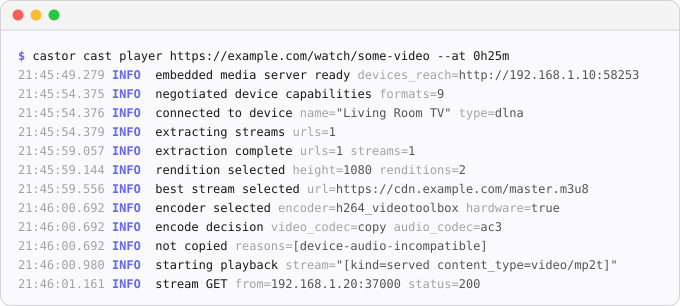
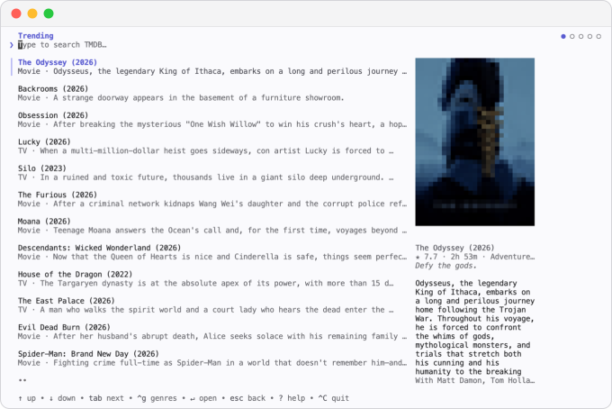
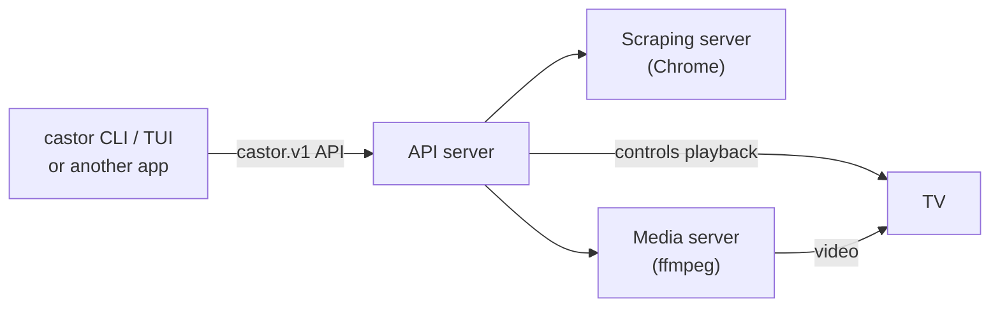

<p align="center">
  
</p>

<p align="center">
  <a href="https://trendshift.io/repositories/86848?utm_source=trendshift-badge&amp;utm_medium=badge&amp;utm_campaign=badge-trendshift-86848" target="_blank" rel="noopener noreferrer"></a>
</p>

<p align="center">
  <a href="https://github.com/stupside/castor/releases/latest">
    
  </a>
  <a href="https://pkg.go.dev/github.com/stupside/castor">
    
  </a>
  <a href="https://github.com/stupside/homebrew-tap/blob/main/Casks/castor.rb">
    
  </a>
  <a href="https://www.npmjs.com/package/@castor-dev/cli">
    
  </a>
  <a href="https://github.com/stupside/castor/blob/main/LICENSE">
    
  </a>
  <a href="https://github.com/stupside/castor/actions">
    
  </a>
</p>

# Castor

Cast web video to your TV, even when it has no built-in casting like Chromecast. Point it at any web page and it finds the video, transcodes it, and streams it to your TV in real time. It even burns in subtitles.

It runs as one command on your laptop, or as [services](#how-it-works) you can move to a NAS.

> [!IMPORTANT]
> Castor ships no content and no sources, and refuses DRM streams. Use it only for video you are allowed to watch.

## Install

```sh
brew install --cask stupside/tap/castor   # macOS
npm install -g @castor-dev/cli            # any platform, Node 20+
```

Or download the [latest release](https://github.com/stupside/castor/releases/latest), or [build from source](CONTRIBUTING.md#building-from-source).

> [!NOTE]
> Castor needs **Chrome** and **ffmpeg + ffprobe 7.1+** on your `PATH`. On Windows: `winget install Google.Chrome` and `winget install Gyan.FFmpeg`, then allow Castor on private networks.

## Quick start

Settings go in a `config.yaml` ([where](#configuration)).

### Cast a page or a video URL

Give castor a page that plays a video: it finds the stream, converts what your TV can't play, and starts playback.

<p align="center">
  
  <br/>
  <em>Casting a page to a DLNA TV with <code>castor cast player</code></em>
</p>

1. Find your TV:

   ```sh
   castor scan
   ```

2. Add it to `config.yaml`, with the name and type the scan printed:

   ```yaml
   device:
     name: "Living Room TV"
     type: dlna   # dlna, chromecast, or roku
   ```

3. Cast a page, or a direct stream or video file:

   ```sh
   castor cast player https://example.com/watch/some-video
   castor cast url https://example.com/video.m3u8
   ```

Useful flags: `--at 1h12m` to start at a position, `--dry-run` to list the streams found without casting, `--debug` to see why castor does what it does.

### Browse titles in the TUI

`castor cast` opens a title browser in your terminal: search TMDB or browse what is trending, pick a title and a TV, and castor finds it on your sources.

<p align="center">
  
  <br/>
  <em>Picking a title in <code>castor cast</code></em>
</p>

1. Add a free [TMDB key](https://www.themoviedb.org/settings/api) and the sites you are authorized to use:

   ```yaml
   tmdb:
     api_key: "<KEY>"
   sources:
     - proxies: ["https://your-source.example"]
       templates:
         movie: "/embed/movie/{itemID}"
         episode: "/embed/tv/{itemID}/{season}-{episode}"
   ```

2. Run it. The configured device, if any, is preselected:

   ```sh
   castor cast
   ```

To skip the TUI, `castor cast movie <id>` and `castor cast episode <id> --season N --episode N` cast to the configured device.

## How it works

Castor is one binary made of three services:

- **API server** finds your TVs and controls playback. Every client talks to it.
- **Scraping server** opens the page in headless Chrome and captures the video stream.
- **Media server** transcodes with ffmpeg when your TV needs it, and serves the stream.



`castor cast` starts all three in its own process, so there is nothing to set up. Each one is also a command (`castor api-server`, `castor media-server`, `castor scraping-server`) you can run on another machine. Give castor its URL in `config.yaml` and it uses that server; anything without a URL still runs locally.

| Setup | Run on the NAS | Add to your `config.yaml` |
| --- | --- | --- |
| Everything on your computer (default) | nothing | nothing |
| [Transcoding on the NAS](#transcoding-only) | `castor media-server` | `servers.media.url` and its token |
| [Everything on the NAS](#the-whole-stack) | `docker compose up -d` | `servers.api.url` and its token |

## Configuration

The annotated [config.yaml](config.yaml) describes every setting. Castor reads it from your user config directory or the current directory:

| System | User config directory |
| --- | --- |
| Linux | `~/.config/castor/` |
| macOS | `~/Library/Application Support/castor/` |
| Windows | `%AppData%\castor\` |

Layers merge in this order, each over the one before:

1. `castor/config.yaml` in your user config directory
2. `config.yaml` in the current directory
3. the file passed with `--config <path>`
4. `CASTOR_` environment variables, such as `CASTOR_CAST__MAX_HEIGHT=720`

Keep secrets, like your TMDB key, in a git-ignored `config.local.yaml` next to the file. Coming from 1.x? See the [migration guide](migrations/1.x-to-2.0.md).

## Devices

| Protocol | Status | Reported working on |
| --- | --- | --- |
| DLNA / UPnP | Main target | Samsung Q70 and Q80 ([#15](https://github.com/stupside/castor/issues/15)), Philips 50PUD6654 ([#23](https://github.com/stupside/castor/pull/23)) |
| Chromecast | Experimental | Xiaomi TV Box ([#5](https://github.com/stupside/castor/issues/5)), LG C2 in Chromecast mode, from the Android client ([#68](https://github.com/stupside/castor/pull/68)) |
| Roku | Experimental | Not tested on hardware yet |

Also reported working, without saying which protocol:

- Hisense VIDAA TV, [in the device discussion](https://github.com/stupside/castor/discussions/52)

Cast to another TV? Tell us how it went in the [What device do you cast to?](https://github.com/stupside/castor/discussions/52) discussion.

<details>

<summary>Setting up a Roku</summary>

1. Enable Developer Mode: on the remote, press <kbd>Home</kbd> three times, <kbd>Up</kbd> twice, then <kbd>Right</kbd> <kbd>Left</kbd> <kbd>Right</kbd> <kbd>Left</kbd> <kbd>Right</kbd>, and set a web server password.
2. Put that password in `servers.api.devices.roku.password` in `config.local.yaml`.
3. Cast: castor installs its channel the first time.

</details>

## Self-host on a NAS

The Docker image bundles Chrome and ffmpeg. Run it with Linux host networking, so the NAS can find your TVs and they can reach it.

### Transcoding only

Your computer still controls the TV; the NAS transcodes.

1. On the NAS, with `servers.media.token` in its `config.yaml` (add `--device /dev/dri` for Intel VA-API):

   ```sh
   docker run -d --network host -v "$PWD/config.yaml:/config.yaml:ro" \
     ghcr.io/stupside/castor:latest media-server
   ```

2. On your computer:

   ```yaml
   servers:
     media:
       url: http://my-nas:8410
       token: "<same token as the NAS>"
   ```

### The whole stack

The NAS runs all three services; your computer, and any other client, only sends commands.

1. On the NAS, next to [docker-compose.yml](docker-compose.yml) and a `config.yaml` (it can be empty), put one token per service in `.env`:

   ```sh
   CASTOR_SERVERS__API__TOKEN=<random>
   CASTOR_SERVERS__MEDIA__TOKEN=<random>
   CASTOR_SERVERS__SCRAPING__TOKEN=<random>
   ```

2. Run `docker compose up -d`. Remove its `/dev/dri` lines if the NAS has no Intel GPU.
3. On your computer:

   ```yaml
   servers:
     api:
       url: http://my-nas:8411
       token: "<CASTOR_SERVERS__API__TOKEN>"
   ```

Ports, HTTPS and image tags are in [ARCHITECTURE.md](ARCHITECTURE.md#deployment-and-trust).

## Build on the API

Everything the CLI does goes through the public [`castor.v1` API](proto/castor/v1): list devices, find the streams on a page, start, watch or stop a cast. Use it over [Connect](https://connectrpc.com), with generated clients or plain HTTP and JSON.

### Community projects

- [castor-android](https://github.com/kdpkke/castor-android) by [@kdpkke](https://github.com/kdpkke): an Android app that casts from your phone, with castor running on it.

Built something on castor? Open a pull request to add it here.

## Troubleshooting

| Symptom | Check |
| --- | --- |
| No devices found | Discovery stays on one subnet. Set `device.host` to the TV's IP (always on Android/Termux). |
| Two devices share a name | Set `device.id` to the ID `castor scan` prints. |
| Page video not found | The video must start without a click; DRM streams are refused. |
| TV loads but cannot play | Force relayed playback: `CASTOR_CAST__DELIVERY=serve castor --debug cast url <url>`. |
| TV cannot fetch the video | Allow Castor through the firewall; check `servers.media.advertise`. |

<details>

<summary>Ports castor uses, for your firewall</summary>

| Port | Direction | Used for |
| --- | --- | --- |
| UDP 1900 | Discovery | Finding DLNA TVs and Rokus (SSDP) |
| UDP 5353 | Discovery | Finding Chromecasts (mDNS) |
| A random LAN port, or TCP 8410 | TV to castor | The TV fetching the video from the embedded media server, or from a standalone one |
| TCP 8411, 8412 | Clients to castor | A standalone API server and scraping server |
| TCP 8009, 8060 | Castor to TV | Controlling a Chromecast, or a Roku (port 80 to install the channel) |

A DLNA TV is controlled on whatever port it advertises.

</details>

## Contributing

Bug reports, device reports and fixes are welcome: [CONTRIBUTING.md](CONTRIBUTING.md) explains how to build castor and what fits the project. Castor is provided as is, for personal and educational use; you are responsible for using it lawfully and within each site's terms.
